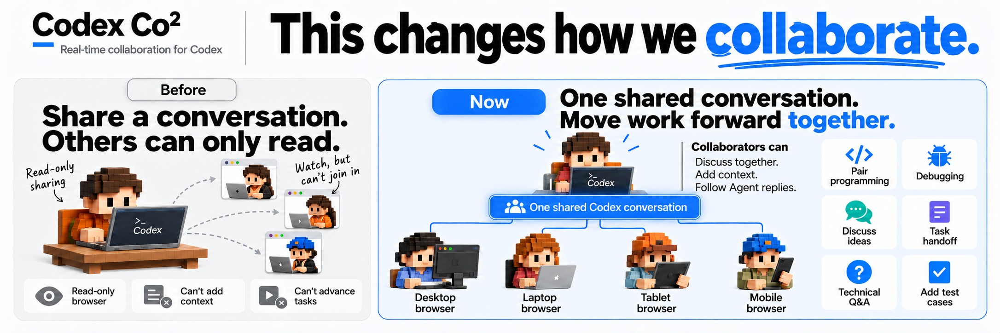
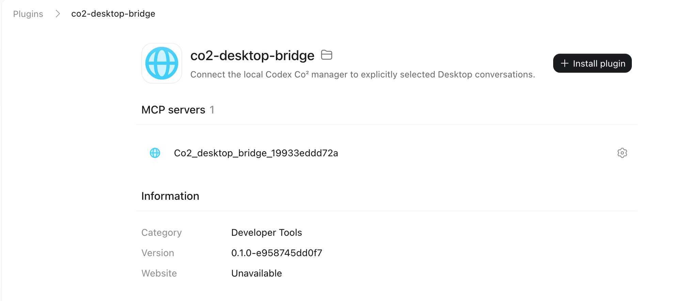
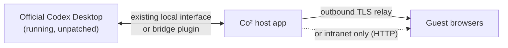

<h1 align="center">Codex Co²</h1>

<p align="center">
  <strong>Real-time collaboration for Codex</strong><br>
  Multiplayer for OpenAI Codex Desktop: teammates join your live Codex conversation from a browser and talk to the same AI coding agent.
</p>

<p align="center">
  
</p>

<p align="center">
  <a href="https://github.com/SpaceCoder-Kafka/codex-co2/releases/tag/v0.5.1"></a>
  
  
  <a href="LICENSE"></a>
</p>

<p align="center">
  <a href="README.md">简体中文</a> · <strong>English</strong>
</p>

## Quick start

On the host Mac, keep official Codex Desktop running and install:

```sh
brew tap SpaceCoder-Kafka/tap && brew install --cask SpaceCoder-Kafka/tap/codex-co2
```

1. Open Co² and pick a conversation.
2. Generate an invitation and send it privately.
3. Approve your teammate. They join in a browser with no install and no Codex login.

<details>
<summary>Codex opened a plugin page?</summary>

Newer Codex Desktop versions connect through the Co² bridge plugin. Click **Install plugin** in the upper right and confirm, and Co² connects automatically. If Co² has stopped waiting, click **Reconnect Codex** once.



</details>

Prefer a DMG or Windows build? Download from [Releases](https://github.com/SpaceCoder-Kafka/codex-co2/releases/tag/v0.5.1). Packages aren't notarized yet, so macOS asks you to confirm the first launch.

**If Co² helps your team, give it a ⭐ so other Codex users can find it.**

## Why Co²

- **Pair program with one Agent.** Your teammate follows the conversation as it unfolds and adds context or the next instruction directly.
- **Hand off without losing context.** **Import to my Codex** gives a teammate an independent copy on their own computer.
- **Run a live review.** Reviewers follow replies and attachments in the browser. You keep control of tool approvals.

| | Screen sharing | Copy-paste the chat | **Codex Co²** |
| --- | --- | --- | --- |
| Collaborators can message the Agent | ❌ | ❌ | ✅ |
| History and new replies stay in sync | While watching | ❌ | ✅ |
| Collaborators install | Meeting app | — | Nothing |
| Continue in your own Codex | ❌ | Manual | ✅ |

## Demo video

https://github.com/user-attachments/assets/48bdea87-13fd-4f78-95a4-91dcac648644

## How it works



Co² attaches to the Codex Desktop you already have open. It doesn't restart, patch or replace it, and it stops if the interface is incompatible. Only the conversation you pick is shared, guest messages land in that conversation, and the Agent keeps running on your machine.

## Security at a glance

- **Same Agent, same permissions.** Guest messages use the conversation's existing tools, sandbox and usage allowance. Invite only people you trust.
- **One conversation only.** Your other conversations and Codex credentials are never shared.
- **You stay in control.** You approve each guest, can require approval for every message, and can revoke access at any time. Tool approvals stay in Desktop.
- **Not end-to-end encrypted.** Public sharing relies on TLS and the relay. Intranet-only mode uses plain HTTP on your private network.
- **Revoking stops new delivery.** It can't erase what a guest already copied.

## Learn more

[Website](https://spacecoder-kafka.github.io/codex-co2/) · [Changelog](CHANGELOG.md) · [Contributing](CONTRIBUTING.md) · [Security policy](SECURITY.md)

Questions or bugs? Open an [issue](https://github.com/SpaceCoder-Kafka/codex-co2/issues).

<sub>Codex Co² (Codex Conversation Collaboration) is an independent experimental project, not an official OpenAI product or an OpenAI-endorsed integration. Project code uses [MIT](LICENSE). See [licenses for bundled components and project visuals](THIRD_PARTY_NOTICES.md).</sub>
