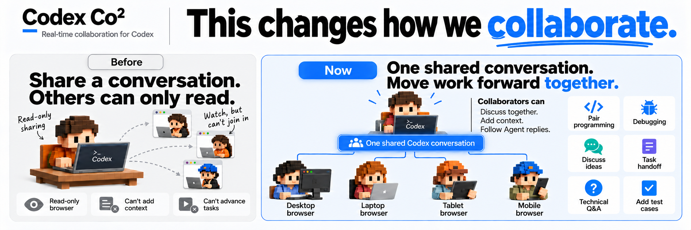
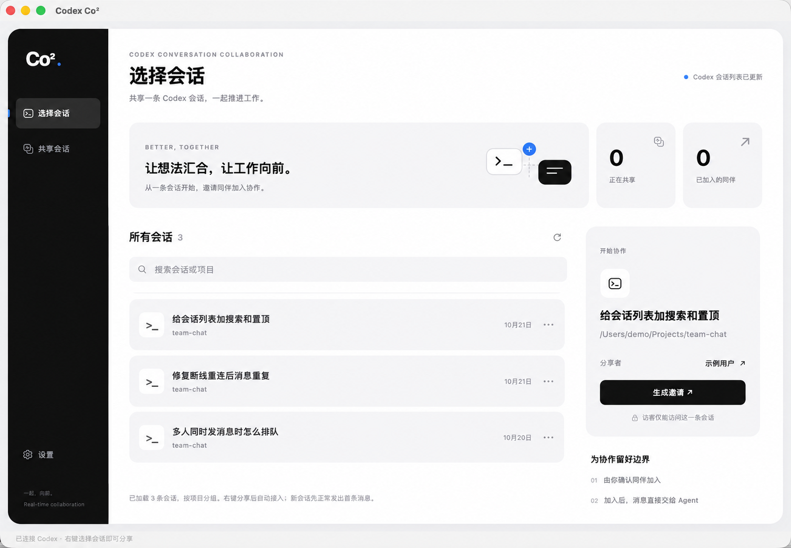
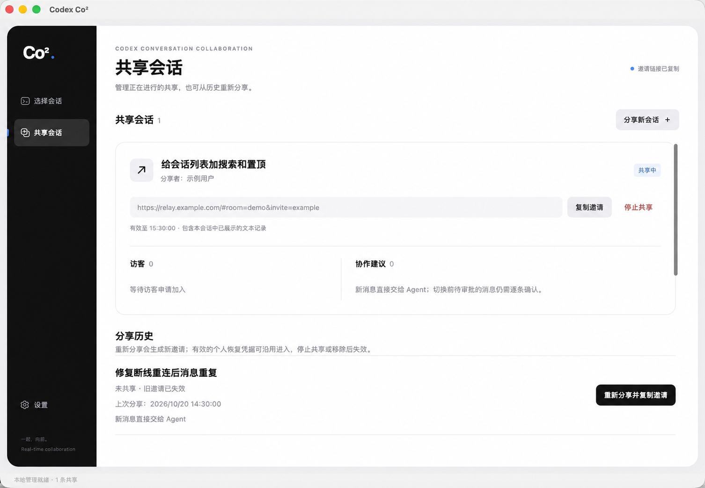
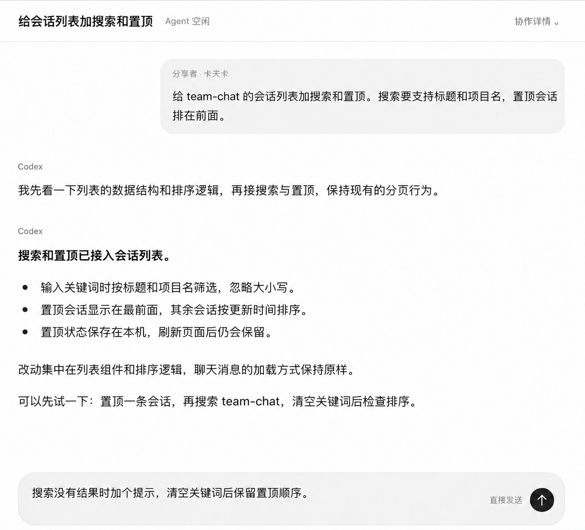
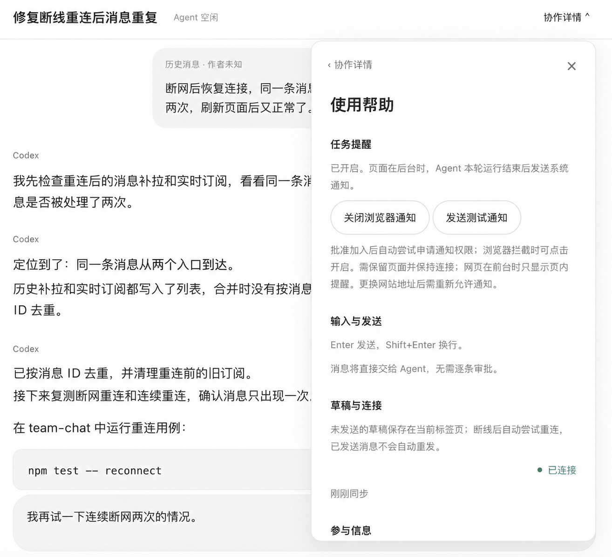

<h1 align="center">Codex Co²</h1>

<p align="center">
  <strong>Real-time collaboration for Codex</strong><br>
  Share the same Codex conversation and move the work forward together.
</p>

<p align="center">
  Keep working in Codex Desktop while collaborators join in a browser to discuss the work,<br>
  add context, and follow the Agent's replies.
</p>

<p align="center">
  
</p>

<p align="center">
  <a href="https://github.com/SpaceCoder-Kafka/codex-co2/releases/tag/v0.3.3-preview.17"></a>
  
  
  <a href="LICENSE"></a>
</p>

<p align="center">
  <strong>English</strong> · <a href="README.zh-CN.md">简体中文</a>
</p>

<p align="center">
  <a href="https://github.com/SpaceCoder-Kafka/codex-co2/releases/tag/v0.3.3-preview.17">Download</a> ·
  <a href="#new-users-install-with-homebrew">Quick start</a> ·
  <a href="#screenshots">Screenshots</a> ·
  <a href="#what-sharing-grants">Sharing boundaries</a> ·
  <a href="#common-questions">FAQ</a>
</p>

Codex Co² stands for **Codex Conversation Collaboration**. This is an independent experimental project, not an official OpenAI product or an OpenAI-endorsed integration.

## Screenshots

Choose a conversation in the host app, manage sharing, and collaborate with the same Agent from a browser. The screenshots below show the Chinese interface with demo content; click an image to view it at full size.

<table>
  <tr>
    <td align="center" width="50%">
      <strong>Choose a conversation</strong><br>
      <a href="assets/screenshot-session-picker-demo-cn.png"></a>
    </td>
    <td align="center" width="50%">
      <strong>Manage sharing</strong><br>
      <a href="assets/screenshot-sharing-demo-cn.png"></a>
    </td>
  </tr>
  <tr>
    <td align="center" width="50%">
      <strong>Collaborate in a browser</strong><br>
      <a href="assets/screenshot-web-conversation-demo-cn-v2.png"></a>
    </td>
    <td align="center" width="50%">
      <strong>Notifications and help</strong><br>
      <a href="assets/screenshot-web-debug-demo-cn.png"></a>
    </td>
  </tr>
</table>

## Demo video

https://github.com/user-attachments/assets/743766be-3549-4928-9f1e-d720314f8989

[Download the promotional video](assets/promotional_video_en.mp4)

## Try the preview

The macOS preview attaches to your **already running official Codex Desktop**, keeping its existing Agent, login and tool approval settings.

- **Published Build 17 host:** Apple Silicon Mac, macOS **15.0+**. Native checks have only been recorded on macOS **26.4.1** with Codex Desktop **26.1007.30912**; other combinations are unverified.
- **Guest:** a browser with JavaScript and WebSocket support.
- **Network:** both participants need access to the generated public address. The default temporary entry uses Cloudflare Quick Tunnels.

### Universal macOS and Windows candidates

The source build now targets these desktop packages; the published Build 17 downloads above remain Apple Silicon packages requiring macOS 15+.

| Package | Target | Acceptance |
| --- | --- | --- |
| Universal DMG | macOS 14+; Apple Silicon and Intel | Two native slices; macOS 14, Intel and clean-Mac native acceptance still required |
| Windows setup EXE and portable ZIP | Windows 10 version 1809+ / Windows 11, x64 | Native Windows Desktop, installation and tool-approval acceptance still required |

Both attach to an already running official Codex Desktop; guests continue to use a browser. Windows uses Microsoft Edge WebView2 Runtime and offers manual updates through the project Releases page. Preview packages remain ad-hoc signed/unnotarized on macOS and unsigned on Windows. Linux packages are not built.

### New users: install with Homebrew

These steps are for the host. Guests only need to open an invitation in their browser.

Install [Homebrew](https://brew.sh/) if needed, and keep official Codex Desktop running. Then install Codex Co² from the [project's tap](https://github.com/SpaceCoder-Kafka/homebrew-tap):

```sh
brew tap SpaceCoder-Kafka/tap
brew install --cask SpaceCoder-Kafka/tap/codex-co2 && open "$(brew --repository SpaceCoder-Kafka/tap)/guides/homebrew.html"
```

If your Homebrew version requests explicit cask trust, review the cask and run `brew trust --cask SpaceCoder-Kafka/tap/codex-co2`, then retry installation.

The command opens a local first-launch guide after successful installation. Use the **中文 / English** buttons at the top to choose your language. Homebrew has already placed the app in Applications, so no drag-and-drop step is needed. If you already installed it, run `brew update` and then only the `open` command above; reinstalling is unnecessary.

### Install from a DMG

Alternatively, download the DMG and matching `.sha256` file from [Releases](https://github.com/SpaceCoder-Kafka/codex-co2/releases/tag/v0.3.3-preview.17), then check the file:

```sh
shasum -a 256 -c Codex-Co2-0.3.3-build17-arm64-preview.dmg.sha256
```

The preview is **ad-hoc signed and not notarized by Apple**. macOS may block its first launch. Attempt to open Co² from Applications, then go to **System Settings → Privacy & Security → Open Anyway** and confirm. Homebrew installs the app directly without showing the DMG's installation window. See [Apple's guidance](https://support.apple.com/en-us/102445).

### About and updates

Build 17 and later provide **About** in the sidebar and the macOS app menu. About shows the installed version, channel and build, offers **Check for updates**, and links to GitHub and release notes. The dismissible Star invitation opens the project repository in your browser.

The app checks for updates at most once a day in the background. Preview builds receive newer preview and stable builds; stable builds receive stable updates. Click **Update to…** to download and verify an update. If sharing is active, confirm that it can end before Co² installs and restarts. Official Codex Desktop stays running; share again after updating. Canceling installation does not schedule it for your next quit. Source/browser mode and read-only disk images offer manual downloads instead.

Build 16 and earlier need one manual upgrade through Homebrew or a DMG before in-app updates are available. Stop sharing and quit Co² first. For Homebrew, include `--greedy` because the cask supports self-updating:

```sh
brew update
brew upgrade --cask --greedy SpaceCoder-Kafka/tap/codex-co2
```

In-app updates verify signed update metadata and packages and remain subject to macOS security checks.

### Host: share a conversation

1. Install through Homebrew, or open the DMG and drag **Codex Co²** into **Applications**. For a manual replacement, stop sharing, turn off background running if available, then quit the old Co² app from its menu bar menu.
2. Keep official Codex Desktop running, then open Co² from Applications.
3. Review your display name and message approval preference in **Settings**.
4. Select an existing conversation with at least one message and generate an invitation. If Codex comes to the foreground to load the conversation, simply switch back to Co².
5. Send the invitation privately and approve your collaborator's request to join.

### Guest: join and collaborate

1. Open the invitation in a browser, enter a display name and request access.
2. After admission, read the shared conversation and send messages to its Agent.
3. By default, new messages enter the Agent directly. If the host enables message approval, wait for the host's decision.
4. After admission, the page automatically attempts to request notification permission if undecided. If your browser blocks the automatic request, click **Enable notifications** in the page prompt or **Collaboration details → Help**. Reconnecting does not repeat the request, and explicitly disabling notifications prevents automatic requests. Use **Send test notification** to check display and click behavior. A different invitation origin needs its own notification permission. If the browser accepts the test but no banner appears, check Chrome's system notification settings and Focus mode. Keep the page open and connected. Supported browsers can notify you while the page is in the background; clicking the notification returns to that page. A run ending does not necessarily mean it succeeded.

The host can remove a collaborator, stop one share or stop all sharing. Closing the management window leaves the app in the menu bar. With the macOS background service enabled and authorized, **Quit** closes the management interface while sharing continues. Without it, quitting ends sharing. Stopping sharing always revokes access, but does not cancel work already dispatched to the Agent.

### Background running on macOS

Current macOS source builds add **Settings → Background running**. The setting is on by default: after macOS permits the background item, the local sharing service keeps running when you quit the management interface and starts again when the same user logs in. It does not start or modify official Codex Desktop. Existing collaboration still needs Desktop; the saved intranet recovery page can accept requests while Desktop is closed. Open Desktop before approving a request or creating a share.

If macOS requires approval or prevents background operation, Co² shows that state and can run only in the foreground. Starting this fallback clears previously saved recovery eligibility and does not preserve it across service restarts. Some changes take effect the next time you open Co²; follow the status shown in Settings. Turning the setting off immediately disables automatic startup and clears saved recovery eligibility. Current foreground sharing can continue until you quit Co². Native host notifications are not guaranteed while the management interface is closed; reopen it to review pending requests.

This background service is macOS-only in this version. Windows, browser and CLI management do not expose the native setting.

### Recover an expired invitation

If an invitation expires or sharing ends because of a system interruption, the original page can offer **Request invitation recovery** once it confirms recovery is available. Enter a display name and submit. After the page confirms that the request is awaiting the host, keep it open or **reopen the original invitation in the same browser** later to check the result. The browser saves a request receipt; if storage is unavailable, the page asks you to keep it open. Closing the page disables live updates; there is no push delivery while it is closed.

In **Shared conversations → Invitation recovery requests**, the host can approve and allow joining, or decline. Approval reuses the conversation's current valid invitation, or starts a new share, and admits only this requester. It does not interrupt other collaborators or admit every holder of the old link. The requester supplies their display name; it is not a verified identity.

Recovery is available with Co²'s built-in sharing service; external or standalone relays do not support it yet. The recovery window lasts up to **7 days** after expiry or interruption. A request lasts up to **24 hours**, bounded by that window; approved results and unused admission permissions also expire with the target share. Restarting does not extend these deadlines. Stopping sharing revokes eligibility; a declined or removed guest cannot regain access through their original request.

With the managed macOS background service active, intranet recovery metadata and credential hashes are saved privately. Conversation content and raw invitation, receipt or visitor credentials are not saved by this recovery store. The service reuses the selected private IP and saved port. If either is unavailable, it waits for that exact address and port; it does not choose another IP or port, track address changes with mDNS, or fall back to public sharing. Once the original entry returns, an old invitation can request recovery again.

A whole-service restart does **not** reopen active rooms or restore admission. Pending requests survive; an interrupted approval requires the host to retry. Previously approved results become unavailable, and unused admission permissions are not reissued. No old messages are resent. The host must explicitly approve a new recovery before collaboration resumes.

A public Quick Tunnel can stay alive while its background service keeps running, but its temporary hostname cannot be preserved across tunnel or computer restarts. If the original entry cannot return, or the host changes it, ask for another invitation.

## What sharing grants

- Admission grants access to the selected conversation's projected history and future messages, including history from before sharing. Long histories may be truncated. Supported user images, MP4 and text attachments can be viewed. Images in assistant Markdown replies appear in place and can be enlarged: absolute local PNG, JPEG and WebP files (up to 8 MiB each) use the admitted room connection; HTTP(S) images load directly in the guest browser without a referrer. Not all Desktop content is projected.
- Guest messages enter the **same Agent**, using the conversation's existing tools, sandbox, permissions and billing or usage allowance. This is not a separate execution sandbox. Invite people you trust.
- Only the local host can change message approval. Changes affect new messages; already pending messages still need a decision. **Native tool approvals remain in official Desktop**; message approval does not replace them.
- The authenticated local manager reads IDs, titles, update times and project paths from the Desktop index. That catalog is not sent to guests or the relay. Selected content is read through Desktop IPC; the app does not copy default credentials or conversation files.
- Public sharing uses ordinary TLS and trusts the relay/tunnel infrastructure. **It is not end-to-end encrypted.** Host disconnection pauses collaboration; some failures require a new invitation. Temporary URLs may change and availability is not guaranteed. [Quick Tunnels are intended for testing and development](https://developers.cloudflare.com/tunnel/get-started/quick-tunnels/).
- Source builds add **Settings → Access scope → Intranet only**. Select a private IPv4 address and save, then invite colleagues through the private IP without creating a Cloudflare entry. End existing shares before changing scope. **Direct intranet access uses unencrypted HTTP; browser system notifications are unavailable.** Chat, admission and message approval remain available. This restricts the collaboration entry; model, tool and remote-image traffic keep their existing network behavior. Cross-device access and company firewall rules still need field acceptance.
- When creating an intranet invitation, choose **1 hour, 1 day, 7 days or Permanent**. Timed invitations end sharing at a fixed deadline and do not roll forward. Permanent removes that deadline; stopping sharing, replacing the entry, or loss of service, network or Desktop availability can still end access. With macOS background running enabled and the original intranet address available, an old link can request recovery after restart; it does not automatically restore access.
- Invitations, visitor recovery files and request receipts are sensitive. Browser storage may retain visitor identities and request receipts. Revoking access stops further delivery but cannot erase content a recipient has already copied or saved.

Review history and attachments before sharing. Avoid disclosing secrets or material you do not have permission to share.

## Common questions

**Does the guest need a Codex account?** Browser access to Co² does not require a separate Codex login. Messages use the host's running conversation and its existing allowance.

**Why can't I connect?** Confirm official Desktop is running, has a nonempty conversation, and exposes a compatible local interface. Co² fails closed if unavailable or incompatible. It does not restart Desktop, replace a profile or create a fallback backend. Desktop updates may affect compatibility.

**Why has my invitation stopped working?** Public invitations renew with a compatible relay and healthy connections, keeping the same link; the Cloudflare temporary hostname has no one-hour hard deadline. Timed intranet invitations end sharing at their fixed deadline. Permanent invitations still depend on the host and network. Brief disconnections retry first. For expiry or system interruption with a reachable original entry, follow the page's recovery prompt. Stopping sharing, changing the entry or unavailable recovery requires the host to send another invitation. A macOS background service can preserve the original intranet recovery entry across restart; active access still needs a new host decision. Choose “Got it” to dismiss an ended share while keeping its history and eligible recovery requests. Check uncertain submissions in Desktop before resending.

**What has been verified?** Synthetic tests cover admission, message policy, scoped transport and revocation. Earlier manual sessions verified individual local/public paths. The current release candidate still needs final-package native Desktop, native tool approval and clean-Mac download/install acceptance. Scripted RPC tests do not prove native UI behavior.

## Run or build from source

Use Node.js **22.23.3** (the pinned bundle runtime), npm, a compatible running Codex Desktop, and `cloudflared` **2026.10.1** for public sharing. From the cloned repository:

```sh
npm ci --ignore-scripts
npm run host -- --attach --public --open
```

Open the local manager printed by the command. Without `--public`, access stays local. No separate Codex CLI is needed for attachment.

For direct intranet access from source, run `npm run host -- --attach --intranet-only --open`. If multiple private addresses are detected, select the sharing address in the manager or specify a current interface address with `--lan-address 192.168.1.20`. Intranet mode never falls back to public sharing after failure. Check the connection and share again after an address change. Company routing, VPN and Wi-Fi client isolation still determine whether devices can reach each other.

Building the Universal DMG needs Apple Silicon or Intel macOS, Xcode command line tools, Python 3.9+ and network access:

```sh
npm run build:macos
npm run check:macos
```

The macOS 14 candidate rebuilds the pinned cloudflared source with a verified Go toolchain. Build tools and caches stay local to the repository; no global Go installation is required. Package checks inspect every native slice's deployment target. They do not establish that Desktop attachment, tool approvals or installation work on macOS 14.

For Windows packages, install .NET SDK 8.0.426, Python 3.9+, NSIS 3.13 and npm dependencies, then run:

```sh
npm run build:windows
npm run check:windows
```

The Windows shell is self-contained; users do not need a separate .NET installation. Cross-building creates Windows artifacts but does not establish native Windows acceptance. See [CONTRIBUTING](CONTRIBUTING.md) for tool overrides and checks.

Outputs are in ignored `dist/`. Builds download pinned runtimes, install clean locked production dependencies, include license notices and run local regressions. See [CONTRIBUTING](CONTRIBUTING.md) for developer tests.

## Feedback and license

Use this repository's Issues for reproducible bugs and suggestions. Include app/build and Desktop versions; remove private messages, paths, invitations and recovery credentials. Report vulnerabilities privately as described in [SECURITY](SECURITY.md).

Project code is under [MIT](LICENSE). Bundled components retain their [own licenses](THIRD_PARTY_NOTICES.md). See [asset provenance](ASSET_PROVENANCE.md) for visuals.
