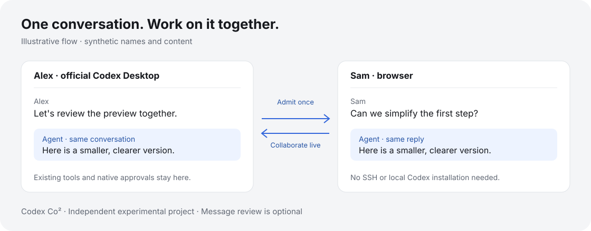

# Codex Co²

**Real-time collaboration for Codex** · [简体中文](README.zh-CN.md)

Share a Codex conversation and move the work forward together.

Keep working in the official Codex Desktop while a collaborator joins the same conversation in a browser. Discuss a change, add context while the Agent is busy, and follow its replies together. Your collaborator does not need SSH access or a local Codex installation.



*Illustration with synthetic content; not a screenshot or native acceptance evidence.*

Codex Co² means **Codex Conversation Collaboration**. This is an independent experimental project, not an official OpenAI product or an OpenAI-endorsed integration.

## Try the preview

The macOS preview attaches to your **already running official Codex Desktop**, keeping its existing Agent, login and tool approval settings.

- **Host:** Apple Silicon Mac. Current bundle requires macOS **15.0+**. Native checks have only been recorded on macOS **26.4.1** with Codex Desktop **26.1007.30912**; other combinations are unverified.
- **Guest:** a browser with JavaScript and WebSocket support. Real mobile-device acceptance remains pending.
- **Network:** both participants need access to the generated public address. The default temporary entry uses Cloudflare Quick Tunnels.

When published, the DMG and matching `.sha256` file will be in this repository's **Releases** section. No public download URL has been configured yet. Download from the project's release page, then check the file:

```sh
shasum -a 256 -c Codex-Co2-0.3.3-build10-arm64-preview.dmg.sha256
```

The preview is **ad-hoc signed and not notarized by Apple**. macOS may block its first launch. Read the DMG's installation instructions and [Apple's guidance](https://support.apple.com/en-us/102445). Only approve an app whose source you trust. A checksum detects a changed download; it does not establish publisher identity.

### Host: share a conversation

1. Open the DMG and drag **Codex Co²** into **Applications**. For an update, stop sharing and quit the old Co² app first.
2. Keep official Codex Desktop running, then open Co² from Applications.
3. Review your display name and message approval preference in **Settings**.
4. Select an existing conversation with at least one message and generate an invitation. Codex may come to the foreground if that conversation needs loading.
5. Send the invitation privately and approve your collaborator's request to join.

### Guest: join and collaborate

1. Open the invitation in a browser, enter a display name and request access.
2. After admission, read the shared conversation and send messages to its Agent.
3. By default, new messages enter the Agent directly. If the host enables message approval, wait for the host's decision.

The host can remove a collaborator, stop one share or stop all sharing. Closing the management window leaves the app running in the menu bar; **Quit** ends sharing. Stopping sharing does not cancel work already dispatched to the Agent.

## What sharing grants

- Admission grants access to the selected conversation's projected history and future messages, including history from before sharing. Long histories may be truncated. Supported user images, MP4 and text attachments can be viewed; not all Desktop content is projected.
- Guest messages enter the **same Agent**, using the conversation's existing tools, sandbox, permissions and billing or usage allowance. This is not a separate execution sandbox. Invite people you trust.
- Only the local host can change message approval. Changes affect new messages; already pending messages still need a decision. **Native tool approvals remain in official Desktop**; message approval does not replace them.
- The authenticated local manager reads IDs, titles, update times and project paths from the Desktop index. That catalog is not sent to guests or the relay. Selected content is read through Desktop IPC; the app does not copy default credentials or conversation files.
- Public sharing uses ordinary TLS and trusts the relay/tunnel infrastructure. **It is not end-to-end encrypted.** Host disconnection pauses collaboration; some failures require a new invitation. Temporary URLs may change and availability is not guaranteed. [Quick Tunnels are intended for testing and development](https://developers.cloudflare.com/tunnel/get-started/quick-tunnels/).
- Invitations and visitor recovery files are sensitive. Browser storage may retain a visitor identity. Revoking access stops further delivery but cannot erase content a recipient has already copied or saved.

Review history and attachments before sharing. Avoid disclosing secrets or material you do not have permission to share.

## Common questions

**Does the guest need a Codex account?** Browser access to Co² does not require a separate Codex login. Messages use the host's running conversation and its existing allowance.

**Why can't I connect?** Confirm official Desktop is running, has a nonempty conversation, and exposes a compatible local interface. Co² fails closed if unavailable or incompatible. It does not restart Desktop, replace a profile or create a fallback backend. Desktop updates may affect compatibility.

**Why has my invitation stopped working?** Shares expire; disconnects and revocation can require fresh admission or a new invitation. Explicitly share again in Co². Check uncertain submissions in Desktop before resending.

**What has been verified?** Synthetic tests cover admission, message policy, scoped transport and revocation. Earlier manual sessions verified individual local/public paths. The current release candidate still needs final-package native Desktop, native tool approval and clean-Mac download/install acceptance. Scripted RPC tests do not prove native UI behavior.

## Run or build from source

Use Node.js **22.23.3** (the pinned bundle runtime), npm, a compatible running Codex Desktop, and `cloudflared` **2026.10.1** for public sharing. From the cloned repository:

```sh
npm ci --ignore-scripts
npm run host -- --attach --public --open
```

Open the local manager printed by the command. Without `--public`, access stays local. No separate Codex CLI is needed for attachment.

Building needs Apple Silicon macOS, Xcode command line tools, Python 3.9+ and network access:

```sh
npm run build:macos
npm run check:macos
```

Outputs are in ignored `dist/`. Builds download pinned runtimes, install clean locked production dependencies, include license notices and run local regressions. See [CONTRIBUTING](CONTRIBUTING.md) for developer tests.

## Feedback and license

Use this repository's Issues for reproducible bugs and suggestions. Include app/build and Desktop versions; remove private messages, paths, invitations and recovery credentials. Report vulnerabilities privately as described in [SECURITY](SECURITY.md).

Project code is under [MIT](LICENSE). Bundled components retain their [own licenses](THIRD_PARTY_NOTICES.md). See [asset provenance](ASSET_PROVENANCE.md) for visuals.
