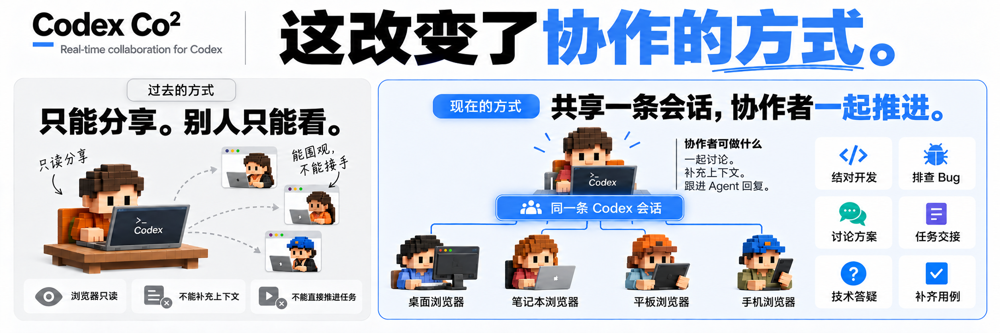
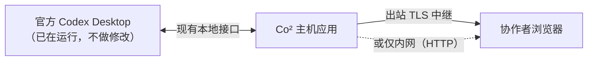

<h1 align="center">Codex Co²</h1>

<p align="center">
  <strong>共享一条 Codex 会话，一起推进工作。</strong><br>
  团队成员用浏览器加入你正在进行的 Codex 会话，直接与同一个 AI 编程 Agent 对话。
</p>

<p align="center">
  
</p>

<p align="center">
  <a href="https://github.com/SpaceCoder-Kafka/codex-co2/releases/tag/v0.5.1"></a>
  
  
  <a href="LICENSE"></a>
</p>

<p align="center">
  <strong>简体中文</strong> · <a href="README.en.md">English</a>
</p>

## 快速开始

在分享者的 Mac 上保持官方 Codex Desktop 运行，然后安装：

```sh
brew tap SpaceCoder-Kafka/tap && brew install --cask SpaceCoder-Kafka/tap/codex-co2
```

1. 打开 Co²，选择一条会话。
2. 生成邀请，私下发给同事。
3. 批准同事加入。对方用浏览器打开即可，无需安装，也无需登录 Codex。

需要 DMG 或 Windows 版本？请从 [Releases](https://github.com/SpaceCoder-Kafka/codex-co2/releases/tag/v0.5.1) 下载。安装包尚未经过公证，macOS 首次打开时需要确认。

**如果 Co² 对你的团队有帮助，欢迎点一个 ⭐，让更多 Codex 用户发现它。**

## 为什么用 Co²

- **和同一个 Agent 结对编程。** 同事能看到 Agent 已经尝试过的一切，直接补充上下文或给出下一步指令。
- **交接工作不丢上下文。** 通过「导入到我的 Codex」，同事可以在自己电脑上得到一份独立副本继续推进。
- **现场评审。** 评审者在浏览器中跟进回复和附件，工具审批仍由你掌控。

| | 屏幕共享 | 复制粘贴对话 | **Codex Co²** |
| --- | --- | --- | --- |
| 协作者能给 Agent 发消息 | ❌ | ❌ | ✅ |
| 历史与新回复保持同步 | 仅限观看时 | ❌ | ✅ |
| 协作者需要安装 | 会议软件 | — | 无需安装 |
| 在自己的 Codex 中继续 | ❌ | 手动 | ✅ |

## 演示视频

https://github.com/user-attachments/assets/48bdea87-13fd-4f78-95a4-91dcac648644

## 工作原理



Co² 接入你已经打开的 Codex Desktop，不会重启、修改或替换它；Desktop 接口不可用时直接停止接入。只共享你选中的那条会话，Agent 始终在你的电脑上运行。

## 安全要点

- **同一个 Agent，同样的权限。** 协作者消息沿用会话已有的工具、沙箱和额度，请只邀请可信任的人。
- **只共享一条会话。** 你的其他会话和 Codex 凭据都不会共享。
- **控制权在你手里。** 每位协作者都需你批准；可以要求逐条审批消息，也可以随时撤销访问。工具审批仍在 Desktop 中处理。
- **不提供端到端加密。** 公网共享依赖 TLS 和中继；仅内网模式在私有网络中使用未加密的 HTTP。
- **撤权只能阻止后续传输。** 无法收回对方已复制的内容。

## 了解更多

[项目主页](https://spacecoder-kafka.github.io/codex-co2/zh/) · [更新日志](CHANGELOG.md) · [参与贡献](CONTRIBUTING.md) · [安全策略](SECURITY.md)

遇到问题或有建议？请提交 [Issue](https://github.com/SpaceCoder-Kafka/codex-co2/issues)。

<sub>Codex Co²（Codex Conversation Collaboration）是独立实验项目，并非 OpenAI 官方产品，也未获 OpenAI 背书。项目代码使用 [MIT](LICENSE) 许可。随附组件的许可和项目素材的授权范围见[许可说明](THIRD_PARTY_NOTICES.md)。</sub>
