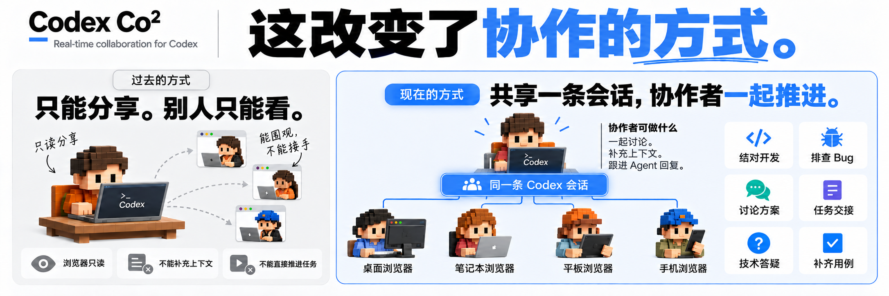

<h1 align="center">Codex Co²</h1>

<p align="center">
  <strong>多人共享同一条 Codex 会话，一起推进工作。</strong><br>
  Real-time collaboration for Codex
</p>

<p align="center">
  分享者一方可以继续在 Codex Desktop 工作，另外几方的协作者则可以通过浏览器加入同一条会话，<br>
  一起讨论、补充上下文、跟进 Agent 的回复。
</p>

<p align="center">
  
</p>

<p align="center">
  <a href="https://github.com/SpaceCoder-Kafka/codex-co2/releases/tag/v0.3.3-preview.17"></a>
  
  
  <a href="LICENSE"></a>
</p>

<p align="center">
  <a href="README.md">English</a> · <strong>简体中文</strong>
</p>

<p align="center">
  <a href="https://github.com/SpaceCoder-Kafka/codex-co2/releases/tag/v0.3.3-preview.17">下载</a> ·
  <a href="#新用户使用homebrew">快速开始</a> ·
  <a href="#应用截图">应用截图</a> ·
  <a href="#共享前需要知道">共享须知</a> ·
  <a href="#常见问题">常见问题</a>
</p>

Codex Co² 全称是 **Codex Conversation Collaboration**。这是独立实验项目，并非 OpenAI 官方产品，也未获 OpenAI 背书。

## 应用截图

从选择会话、管理共享，到协作者通过浏览器与同一个 Agent 一起推进工作。以下为中文界面的示例内容，点击图片可查看大图。

<table>
  <tr>
    <td align="center" width="50%">
      <strong>选择会话</strong><br>
      <a href="assets/screenshot-session-picker-demo-cn.png"></a>
    </td>
    <td align="center" width="50%">
      <strong>管理共享</strong><br>
      <a href="assets/screenshot-sharing-demo-cn.png"></a>
    </td>
  </tr>
  <tr>
    <td align="center" width="50%">
      <strong>浏览器协作</strong><br>
      <a href="assets/screenshot-web-conversation-demo-cn-v2.png"></a>
    </td>
    <td align="center" width="50%">
      <strong>通知与使用帮助</strong><br>
      <a href="assets/screenshot-web-debug-demo-cn.png"></a>
    </td>
  </tr>
</table>

## 演示视频

https://github.com/user-attachments/assets/b1c2f544-3684-432e-9e03-f32ac15b9370

[下载宣传视频](assets/promotional_video_cn.mp4)

## 体验预览版

已发布的 **Build 17** 需要 Apple Silicon Mac、macOS **15.0+** 和已运行的官方 Codex Desktop。原生检查仅记录于 macOS **26.4.1**、Desktop **26.1007.30912**，其他组合尚未验证。协作者使用支持 JavaScript 和 WebSocket 的浏览器；双方网络需能访问生成的公网地址。

### Universal macOS 与 Windows 候选包

源码构建新增以下桌面产物；上方已发布的 Build 17 下载仍为要求 macOS 15+ 的 Apple Silicon 安装包。

| 安装包 | 目标系统 | 验收范围 |
| --- | --- | --- |
| Universal DMG | macOS 14+；Apple Silicon 与 Intel | 包含两种原生架构；macOS 14、Intel 与干净 Mac 原生验收仍待完成 |
| Windows 安装 EXE 与便携 ZIP | Windows 10 1809+ / Windows 11，x64 | 官方 Desktop、安装与原生工具审批仍待 Windows 验收 |

两端均接入已经运行的官方 Codex Desktop，协作者继续使用浏览器。Windows 使用 Microsoft Edge WebView2 Runtime，通过项目 Releases 页面手动更新。预览包在 macOS 上仍为临时签名、未经公证；Windows 包暂未签名。不构建 Linux 包。

### 新用户使用（Homebrew）

以下步骤供分享者使用。协作者只需在浏览器打开邀请，无需安装应用。

如果尚未安装，请先安装 [Homebrew](https://brew.sh/)，并保持官方 Codex Desktop 运行。随后通过[项目 Tap](https://github.com/SpaceCoder-Kafka/homebrew-tap) 安装：

```sh
brew tap SpaceCoder-Kafka/tap
brew install --cask SpaceCoder-Kafka/tap/codex-co2 && open "$(brew --repository SpaceCoder-Kafka/tap)/guides/homebrew.html"
```

如果你的 Homebrew 版本提示需要显式信任 Cask，先检查定义，再执行 `brew trust --cask SpaceCoder-Kafka/tap/codex-co2`，随后重试安装。

安装成功后，上述命令会在默认浏览器打开本地首次使用引导，页面顶部提供 **中文 / English** 切换按钮。Homebrew 已将应用放入 Applications，无需再次拖拽。如果已经安装，只需执行 `brew update`，再单独执行上面的 `open` 命令，无需重新安装。

### 通过 DMG 安装

也可以从 [Releases](https://github.com/SpaceCoder-Kafka/codex-co2/releases/tag/v0.3.3-preview.17) 下载 DMG 和对应 `.sha256` 文件，下载后执行：

```sh
shasum -a 256 -c Codex-Co2-0.3.3-build17-arm64-preview.dmg.sha256
```

预览包采用临时签名，**未经 Apple 公证**，首次打开可能受系统拦截。先尝试从 Applications 打开 Co²，再到「系统设置 → 隐私与安全性 → 仍要打开」确认。Homebrew 会直接安装应用，不会展示 DMG 的安装引导窗口。请参考 [Apple 指引](https://support.apple.com/zh-cn/102445)。

### 关于与更新

Build 17 起在侧栏和 macOS 应用菜单提供「关于」入口，显示实际安装的版本、渠道和 Build，并提供「检查更新」、GitHub 和更新日志。底部可关闭的 Star 提示会在浏览器打开项目仓库。

应用每天最多在后台检查一次。Preview 接收更新的预览版及正式版，正式版只接收正式版。点击「更新到…」下载并校验更新；仍有共享时，确认结束共享后才安装并重开 Co²。官方 Codex Desktop 保持运行，更新后可重新分享。取消安装不会留下下次退出时自动更新的任务。源码浏览器模式和只读安装盘运行提供手动下载入口。

Build 16 及以前需先通过 Homebrew 或 DMG 手动升级一次，之后才能使用应用内更新。升级前先停止共享并退出 Co²。通过 Homebrew 升级时，此 Cask 支持应用自行更新，需加 `--greedy`：

```sh
brew update
brew upgrade --cask --greedy SpaceCoder-Kafka/tap/codex-co2
```

应用内更新会校验更新信息与安装包的签名，仍遵守 macOS 的安全检查。

### 分享者操作

1. 通过 Homebrew 安装，或将 DMG 中的 Codex Co² 拖入 Applications。手动替换前先停止共享；如有后台运行开关，先关闭，再从菜单栏退出旧版 Co²。
2. 保持官方 Desktop 运行，从 Applications 启动 Co²。
3. 在设置中检查显示名称和消息审批选项。
4. 选择已有消息的会话，生成邀请。需要加载目标会话时，Codex 可能会跳转到前台，可无视，切回 Co² 即可。
5. 私下发送邀请，确认协作者身份后批准加入。

### 协作者操作

1. 用浏览器打开邀请，填写名称并申请加入。
2. 获准后阅读共享会话，向同一个 Agent 发送消息。
3. 默认直接接收新消息；分享者开启消息审批时，需等待逐条确认。
4. 批准加入后，网页会在尚未授权时自动尝试申请通知权限；浏览器拦截自动申请时，点击页内「开启通知」即可，也可在「协作详情 → 使用帮助」中开启。重连不重复申请，主动关闭后不自动申请。可点击「发送测试通知」验证显示与点击。更换邀请的网站地址后需重新允许通知；若测试提示已交给浏览器但没有弹窗，请检查系统中的 Chrome 通知设置和专注模式。需保留页面并保持连接；支持的浏览器可在页面处于后台时发送系统通知，点击回到原页面查看结果。运行结束不一定表示执行成功。

分享者可移除协作者、停止单条或全部共享。关闭窗口后应用继续驻留菜单栏；macOS 后台服务已启用且获系统允许时，退出管理界面仍继续共享，否则退出会结束共享。停止共享始终撤销访问，但不会取消已经派发给 Agent 的工作。

### macOS 后台运行

当前 macOS 源码构建新增「设置 → 后台运行」，默认开启。系统允许后台项目后，本机服务会在退出管理界面后继续运行，并在同一用户登录电脑后自动启动。它不会启动或修改官方 Codex Desktop。实际协作仍依赖 Desktop，但已保存的内网恢复页面可在 Desktop 关闭时接收申请；批准恢复或新建共享前，请先打开 Desktop。

系统需要批准或不允许后台运行时，Co² 会显示实际状态，并可仅在前台运行。启动此前台回退会清除旧的持久恢复资格，不保留跨服务重启的恢复能力。部分开启操作需下次打开 Co² 才生效，请以设置中的提示为准。关闭开关会立即取消后台自启并清除已保存的恢复资格；当前前台共享可继续，退出 Co² 才停止。管理界面退出期间不承诺原生通知，请重新打开查看待处理申请。

本版后台服务仅限 macOS。Windows、浏览器与 CLI 管理页不显示这项原生设置。

### 邀请失效后申请恢复

邀请自然到期或共享因系统故障结束后，如果原网页仍可访问，页面会在确认可恢复时显示「请求恢复邀请」。填写昵称并提交，收到「等待分享者处理」后，可保留页面等待，也可稍后用**同一浏览器重新打开原邀请**查看结果。浏览器会保存本次申请回执；若无法保存，页面会提示保持打开。关闭页面期间不会主动推送处理结果。

分享者在「共享会话」中的「邀请恢复申请」选择「同意并允许加入」或「拒绝」。同意会复用该会话当前有效的邀请，或重新创建共享，然后仅批准本次申请者加入；不会打断其他协作者，也不会让所有旧链接持有人自动加入。申请昵称由对方填写，并非已核验身份。

恢复入口仅适用于 Co² 自带分享服务，外部或独立中继暂不支持。恢复窗口从到期或系统中断起最多保留 **7 天**，单次申请最长 **24 小时**，且不超过恢复窗口；获准结果和未使用准入还受目标共享有效期限制。重启不会延长这些期限。主动停止共享会撤销资格，拒绝或移除不能通过原申请重新获得访问权。

macOS 后台服务实际托管运行时，内网恢复元数据与凭据哈希会保存在私有目录。恢复记录不保存正文，也不保存邀请、回执或访客凭据原文。服务复用选定的私网 IP 和保存的端口；地址消失或端口占用时，只等待原地址和端口恢复，不切换地址、端口或公网，也不用 mDNS 追踪 IP 变化。原入口重新可用后，旧邀请可再次申请恢复。

整个服务重启后，**不会自动开放旧房间或恢复准入**。待处理申请保留，中断的审批需分享者手动重试；原获准结果变为不可用，未使用授权不会补发，也不会重发旧消息。协作恢复仍需分享者明确批准。

公网 Quick Tunnel 可在同一后台服务持续运行时保留，但隧道或电脑重启后无法保留原临时域名。原入口无法恢复或分享者更换入口时，仍需另发邀请。

## 共享前需要知道

- 分享包括所选会话投影出的历史与后续消息，不只限于生成邀请之后。长历史可能截断；受支持的用户图片、MP4 和文本附件也可查看。回复中的 Markdown 图片可在原位置显示并点击放大：绝对路径的本地 PNG、JPEG、WebP 图片（每张不超过 8 MiB）通过已准入的房间连接传输；HTTP(S) 图片由访客浏览器直接加载，不发送来源页面地址。不能完整展示所有 Desktop 内容。
- 协作者消息进入现有 Agent，沿用会话的工具、沙箱、权限及计费或额度。**共享不会新建执行沙箱**，请只邀请可信任的人。
- 只有本机分享者能改变消息策略；只影响新消息，已有待审批消息仍需决定。原生工具审批继续在官方 Desktop 处理，消息审批不能替代工具审批。
- 本机管理页只查询会话 ID、标题、更新时间和项目路径，目录不发给中继或协作者；所选正文经 Desktop IPC 读取，不复制默认认证或会话文件。
- 公网使用普通 TLS，信任中继和隧道基础设施，**不提供端到端加密**。主机离线暂停协作，部分故障需新邀请。临时地址可能变化，不保证可用性；[Quick Tunnels 定位为测试开发用途](https://developers.cloudflare.com/tunnel/get-started/quick-tunnels/)。
- 源码新增「设置 → 访问范围 → 仅内网可访问」：选择私网 IPv4 并保存后，同事通过内网 IP 邀请加入，不创建 Cloudflare 入口。切换前需结束已有共享。**内网直连使用未加密的 HTTP，浏览器系统通知不可用**；聊天、准入和消息审批继续保留。仅限制协作入口，模型、工具和外链图片的网络访问沿用原配置；真实跨设备与公司防火墙仍需现场验收。
- 生成内网邀请时可选 **1 小时、1 天、7 天或永久**。定时邀请按固定截止时间结束共享，不会滚动延长；「永久」只表示没有固定到期时间，停止共享、更换入口、服务、网络或 Desktop 不可用仍可结束访问。开启 macOS 后台运行且原内网地址可用时，重启后旧链接可申请恢复，不会自动恢复访问权。
- 邀请、访客恢复文件及申请回执属于敏感凭据，浏览器可能保存访客身份和申请回执。撤权停止后续传输，无法收回对方已复制或保存的内容。

分享前请检查历史与附件，避免泄露秘密或无权披露的材料。协作者无需单独登录 Codex，使用分享者当前运行会话及其额度。

## 常见问题

**无法连接？** 确认官方 Desktop 正在运行、至少有一条非空会话且接口兼容。接口不可用时停止接入，不重启 Desktop、不替换 profile，也不创建备用后端。Desktop 更新可能影响兼容性。

**邀请失效或连接中断？** 公网邀请在中继支持且连接正常时自动续期并保留原链接，Cloudflare 临时域名没有一小时硬性时限。内网定时邀请到固定截止时间就结束共享；永久邀请仍受主机和网络可用性约束。短暂断线先尝试重连；自然到期或系统中断且原入口仍可用时，可按页面提示申请恢复。停止共享、更换入口或无法恢复时，需分享者另发邀请。macOS 后台服务可在重启后恢复原内网页面的申请入口，实际准入仍需分享者重新决定。已结束卡片可点「我知道了」移除，分享历史和仍有效的恢复申请不受影响。发送结果不确定时，先在 Desktop 核对，避免重复发送。

**验证到哪一步？** 合成测试覆盖准入、消息策略、会话传输和撤权；此前人工验证过部分本机与公网协作。当前候选仍需完成最终安装包的官方 Desktop、原生工具审批及干净 Mac 下载与安装验收。RPC 测试不能证明原生窗口行为。

## 从源码运行与构建

使用 Node.js **22.23.3**、npm、兼容且已运行的官方 Desktop；公网另需 `cloudflared` **2026.10.1**。在克隆的仓库执行：

```sh
npm ci --ignore-scripts
npm run host -- --attach --public --open
```

打开命令输出的本地管理页。不加 `--public` 仅本地访问。日常接入无需另装 Codex CLI。

源码内网直连使用 `npm run host -- --attach --intranet-only --open`。如果检测到多个私网地址，在管理页选择共享地址，或使用 `--lan-address 192.168.1.20` 指定当前网卡地址。内网模式不会在失败后回退公网；网络地址改变后需检查并重新分享。公司路由、VPN 或 Wi-Fi 访客隔离仍决定设备能否互通。

Universal DMG 构建另需 Apple Silicon 或 Intel macOS、Xcode 命令行工具、Python 3.9+ 和网络：

```sh
npm run build:macos
npm run check:macos
```

macOS 14 候选包使用经过校验的 Go 工具链重新编译固定版本的 cloudflared 源码。构建工具和缓存保留在仓库内，无需全局安装 Go。包检查会核对每个原生架构的最低系统要求，不能代替 macOS 14 上的 Desktop 接入、工具审批与安装验收。

Windows 构建另需 .NET SDK 8.0.426、Python 3.9+、NSIS 3.13 和 npm 依赖：

```sh
npm run build:windows
npm run check:windows
```

Windows 程序内置 .NET 运行时，用户无需另装 .NET。交叉构建能生成 Windows 文件，不能代替 Windows 原生验收。工具路径与验证说明见 [CONTRIBUTING](CONTRIBUTING.md)。

产物位于忽略提交的 `dist/`。构建使用锁文件安装干净依赖，包含第三方声明并运行本地回归。开发测试见 [CONTRIBUTING](CONTRIBUTING.md)。

## 反馈与许可

普通问题通过 Issues 反馈，附应用构建号与 Desktop 版本，删除私密正文、个人路径、邀请和恢复凭据。安全问题按 [SECURITY](SECURITY.md) 私下报告。

项目代码使用 [MIT](LICENSE)，第三方组件保留[各自许可](THIRD_PARTY_NOTICES.md)。图标及示意图来源见[素材声明](ASSET_PROVENANCE.md)。
